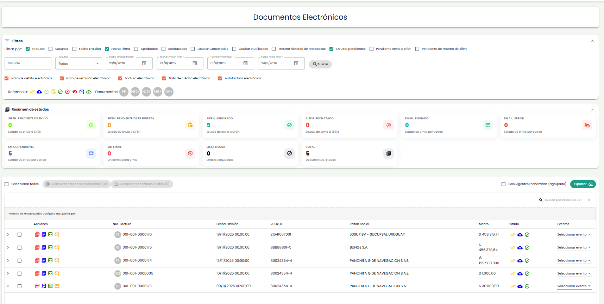
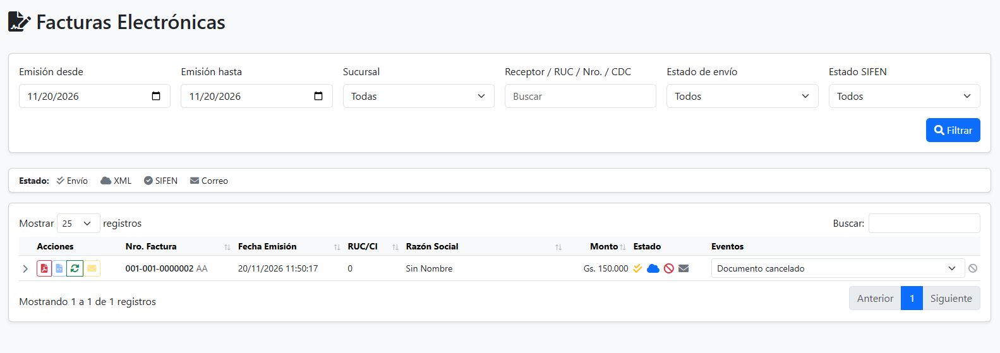

# PRO-365 — Referencias visuales ORIGINALES de la COMPETENCIA

**Fuente principal obligatoria de referencia visual para `/documentos` de NEXIT.** Estas capturas fueron entregadas por el responsable en la conversación el 23/11/2026 y publicadas en GitHub el 24/11/2026. No son de NEXIT ni de BSERP. **BSERP es referencia secundaria, nunca sustituto.**

Se conservaron los dos archivos **PNG originales byte por byte**, sin edición, reducción ni redibujo. Los hashes Git blob se verificaron contra los archivos aportados.

## 1. Competencia — filtros, resumen de estados y tabla

- Archivo: [01_Concorrencia_Filtros_Resumo_Tabela.png](./01_Concorrencia_Filtros_Resumo_Tabela.png)
- Tamaño: 170.841 bytes
- SHA-256 original: `e51c6629705aca14a028c09b8e5e0e6ba69cda6ea6d0e7a2633bbeae4c2f8fb8`
- Git blob SHA-1: `84f3d7bdf5ed9bc12ca59bfcb4a852d3ed5bca0c`

## 2. Competencia — filtros compactos, leyenda, iconos, estados y eventos

- Archivo: [02_Concorrencia_Filtros_Leyenda_Estados.png](./02_Concorrencia_Filtros_Leyenda_Estados.png)
- Tamaño: 61.579 bytes
- SHA-256 original: `87a1eff22c77d5e529e98f9adb450eb4b809f411957b6442a93947a0958087d8`
- Git blob SHA-1: `2ce510015db83496b2c55ef88728dc3e6e2ed9ad`

## Instrucciones de comparación para Claude

1. **Abrir y examinar AMBAS imágenes directamente desde este repositorio, NO pedir otra vez que se adjunten.**
2. Leer la [orden PRO-365](../../ordens/ORD-CLAUDE-NEXIT-PRO-365-UX-COMPETENCIA-R01-2026-11-23.md), incluyendo su matriz y A01–A10.
3. Contrastar la jerarquía visual de filtros, KPIs, acciones, Estado, Eventos, FE/NCE, tablas y paginación con el NEXIT real. Separar los iconos de acción de las cuatro fases Envío · XML/CDC · SIFEN · Correo.
4. La R01 funcional SHA `294f4e29619e54e71d8afcab425d7f3f171881ae` fue revisada estáticamente y pasó CI automático, **pero NO fue homologada visualmente**. Se mantiene el [dictamen ChatGPT](../../testes/AUD-CHATGPT-NEXIT-PRO-365-UX-COMPETENCIA-R01-2026-11-24.md).
5. **No iniciar cambios de código, tests manuales, SQL, build, VM, Docker, gateway, deploy ni merge sin autorización de una nueva ronda específica.** La publicación de estas imágenes no constituye permiso para R02 ni homologación.

Las capturas son una referencia de interfaz, **no** un contrato de API, ni autorización para copiar código/gráficos de terceros o inventar operaciones.
